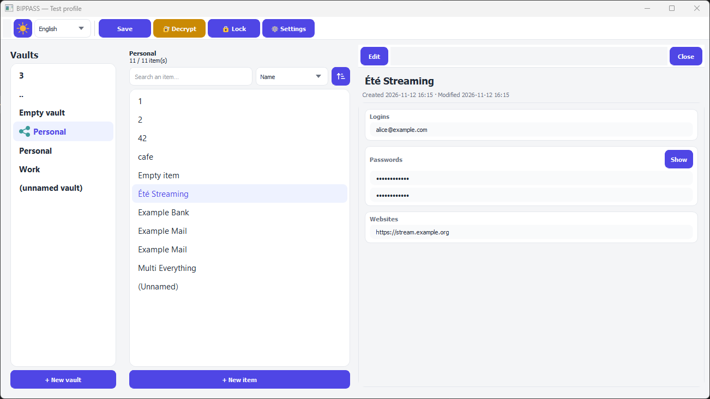

# bippass

bippass est un gestionnaire de mots de passe local et hors ligne, doté d'une interface de bureau PyQt5 et d'une interface en ligne de commande, et construit sur [Artezaru/pyaescbc](https://github.com/Artezaru/pyaescbc) (chiffrement AES-CBC avec contrôle d'intégrité HMAC).

Tout est stocké dans un fichier chiffré par profil, sur votre propre machine : rien n'est envoyé à un serveur, et aucune connexion internet n'est nécessaire.



## Fonctionnalités

- **Profils, coffres et éléments** : chaque profil est un fichier chiffré, organisé en coffres (chacun avec son icône et sa couleur, classés par ordre alphabétique) qui contiennent vos éléments. Les profils peuvent être renommés ou supprimés depuis l'écran de démarrage.
- **Des éléments complets** : identifiants, mots de passe, sites web, adresses email, numéros de téléphone, secrets TOTP et champs personnalisés (en clair ou chiffrés), avec autant de valeurs que nécessaire.
- **Deux niveaux de chiffrement** : le fichier entier est chiffré avec une clé déverrouillée par votre mot de passe primaire, et les mots de passe, secrets TOTP et champs personnalisés chiffrés le sont une seconde fois avec une clé déverrouillée par votre mot de passe secondaire.
- **Générateur de mots de passe** : mots de passe aléatoires (longueur et types de caractères au choix) ou phrases de passe faciles à retenir (mots et chiffres), en anglais, français ou espagnol.
- **Codes TOTP** : codes à 6 chiffres affichés en direct avec leur compte à rebours, calculés localement.
- **Copie en un clic** : cliquez sur une valeur pour la copier (les secrets sont effacés du presse-papiers après 30 secondes) ; double-cliquez sur un site web, une adresse email ou un numéro de téléphone pour l'ouvrir dans votre navigateur, votre messagerie ou votre application d'appel.
- **Organisation rapide** : recherche par nom, tri par nom (ordre naturel : « item2 » avant « item10 »), date de création ou de modification, duplication, et glisser-déposer des éléments d'un coffre à l'autre.
- **Icônes des éléments** : choisissez un logo fourni dans une liste avec recherche, ou utilisez n'importe quelle image, avec une couleur de fond si besoin.
- **Édition sûre** : chaque modification d'un élément reste un brouillon jusqu'à l'enregistrement ; Annuler les abandonne toutes.
- **Export et import** : partagez une sélection d'éléments sous forme de fichier chiffré indépendant, protégé par ses propres mots de passe.
- **Verrouillage automatique** : après une période d'inactivité réglable, bippass enregistre vos modifications, ferme le profil en effaçant ses clés de la mémoire, et revient à l'écran de démarrage.
- **Ligne de commande** : les mêmes profils, parcourus comme un petit système de fichiers (`cd`, `ls`, `show`, `reveal`, `copy`, `totp`...), avec création, édition, export, import et génération de mots de passe.
- **Thème clair/sombre**, zoom réglable et **3 langues** (anglais, français, espagnol), modifiables à la volée.
- **Aide intégrée** : un guide complet de chaque bouton, menu et raccourci clavier, dans votre langue.

## Comment vos données sont protégées

Un profil est protégé par deux mots de passe :

- le **mot de passe primaire** ouvre le fichier du profil : coffres, éléments et leurs champs en clair ;
- le **mot de passe secondaire** déchiffre les secrets qu'il contient (mots de passe, secrets TOTP, champs personnalisés chiffrés). Il n'est demandé que la première fois qu'un secret est nécessaire, et les secrets restent chiffrés en mémoire jusqu'à ce que vous les affichiez ou les copiiez.

Seul le libellé d'un profil (le nom affiché dans la liste des profils) est lisible sans mot de passe ; le nom d'utilisateur est chiffré.

Rien n'est écrit sur le disque tant que vous n'enregistrez pas (le bouton Enregistrer devient orange quand des modifications ne sont pas enregistrées), que vous ne verrouillez pas le profil, que vous ne fermez pas la fenêtre, ou que le délai d'inactivité n'est pas écoulé. Les fichiers sont écrits de façon atomique : un enregistrement interrompu n'abîme jamais un profil. Quand un profil est verrouillé ou que bippass se ferme, ses clés sont effacées de la mémoire.

> **Aucune récupération de mot de passe n'est possible.** Si vous perdez votre mot de passe primaire ou secondaire, le profil ne peut plus être déchiffré. Conservez-les précieusement, et sauvegardez régulièrement vos fichiers de profil.

## Installation

### Exécutables prêts à l'emploi (recommandé)

Téléchargez la dernière version pour votre système sur la [page des versions](https://github.com/Artezaru/bippass/releases) :

- **Windows** : téléchargez et lancez directement `bippass-windows.exe`, sans installation.
- **Linux (Debian/Ubuntu)** : téléchargez le paquet `.deb` et installez-le avec :
  ```bash
  sudo dpkg -i bippass_*.deb
  ```
  bippass apparaît alors dans le menu des applications, et peut aussi être lancé depuis un terminal avec `bippass`.

### Depuis les sources (développeurs)

Nécessite Python 3.10 ou plus récent.

```bash
git clone https://github.com/Artezaru/bippass.git
cd bippass
pip install .
```

Lancez l'interface de bureau avec :

```bash
bippass-gui
```

et l'interface en ligne de commande avec `bippass` (ou `python -m bippass`, qui n'a pas besoin de PyQt5). Avec [rich](https://github.com/Textualize/rich) installé, la ligne de commande est en couleur ; avec [pyperclip](https://github.com/asweigart/pyperclip), la copie fonctionne sur toutes les plateformes.

## Premiers pas

1. Au premier lancement, choisissez **Créer un nouveau profil**. Indiquez un nom d'utilisateur et un libellé (tous deux facultatifs), choisissez le mot de passe primaire, cliquez sur **Suivant**, puis choisissez le mot de passe secondaire. Le profil est enregistré dans `~/.bippass/profiles/` et ouvert.
2. Créez un coffre avec **+ Nouveau coffre**, puis ajoutez-y des éléments avec **+ Nouvel élément**.

Les fois suivantes, choisissez votre profil dans la liste (ou parcourez vos dossiers pour un fichier de profil rangé ailleurs) et saisissez le mot de passe primaire : le secondaire est demandé quand un secret est nécessaire.

En ligne de commande, `create` crée un profil, `load`, `unlock` et `decrypt` en ouvrent un, et `help` liste toutes les commandes.

Les profils de la version précédente (`*.encrypted`) ne sont plus listés : convertissez-les d'abord, avec **⚙ Paramètres → Convertir un profil version 2…** sur l'écran de démarrage, ou avec `python -m bippass.backward.v2_to_v3 <fichier.encrypted>`. Le nouveau profil garde les mêmes mots de passe, et l'ancien fichier n'est pas modifié.

## Aide

Le guide d'utilisation complet est intégré à bippass : ouvrez **⚙ Paramètres → Aide** dans la barre d'outils. Il détaille chaque bouton, menu et raccourci clavier, et s'affiche dans la langue de l'interface (anglais, français ou espagnol) ; comme le reste de l'application, il fonctionne hors ligne. En ligne de commande, `help <commande>` détaille chaque commande.

## Raccourcis clavier

| Raccourci | Action |
| --- | --- |
| `Ctrl+S` | Enregistrer |
| `Ctrl+K` | Enregistrer et quitter |
| `Ctrl+L` | Verrouiller le profil |
| `Ctrl+F` | Rechercher parmi les éléments du coffre |
| `Ctrl+N` | Nouvel élément dans le coffre |
| `Ctrl+E` | Modifier l'élément ouvert |
| `Ctrl +` / `Ctrl =` | Zoom avant |
| `Ctrl -` | Zoom arrière |
| `Ctrl 0` | Réinitialiser le zoom |
| `Ctrl+A` | Sélectionner tous les éléments de la liste (pour les déplacer vers un autre coffre) |
| `Entrée` / double-clic | Ouvrir l'élément sélectionné |

## Où sont vos fichiers

| Chemin | Contenu |
| --- | --- |
| `~/.bippass/profiles/<uuid>.bippass` | Vos profils : **sauvegardez ce dossier**. |
| `~/.bippass/settings.json` | Les réglages de cet ordinateur : le thème de l'écran de démarrage et le dernier profil ouvert. |
| `~/.bippass/logs/bippass.log` | Les erreurs inattendues (détails techniques uniquement, jamais un mot de passe). |

Le thème, la langue et le délai de verrouillage sont par ailleurs stockés dans chaque profil, chiffrés avec lui.

## Licence

bippass est un logiciel libre, distribué sous licence **GNU General Public License v3.0 ou ultérieure**. Voir [LICENSE](LICENSE) pour le texte complet.

## Contribuer

Les signalements de bugs et les pull requests sont les bienvenus. Pour tout changement important, ouvrez d'abord un ticket sur le [tracker](https://github.com/Artezaru/bippass/issues) pour en discuter.
