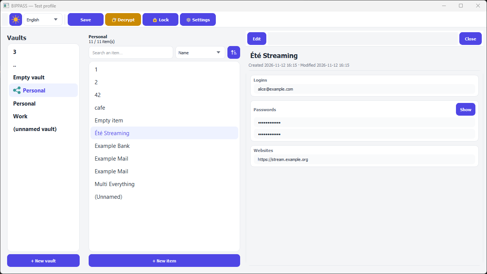

# bippass

bippass is a local, offline password manager with a PyQt5 desktop interface and a command-line interface, built on top of [Artezaru/pyaescbc](https://github.com/Artezaru/pyaescbc) (AES-CBC encryption with HMAC integrity checking).

Everything is stored in a single encrypted file per profile on your own machine: nothing is sent to a server, and no internet connection is required.



## Features

- **Profiles, vaults and items**: each profile is one encrypted file, organized into vaults (with their own icon and color, listed alphabetically) holding your items. Profiles can be renamed or deleted from the start screen.
- **Rich items**: logins, passwords, websites, email addresses, phone numbers, TOTP secrets and custom fields (clear or encrypted), each with as many values as you need.
- **Two layers of encryption**: the whole file is encrypted with a key unlocked by your primary password, and passwords, TOTP secrets and encrypted custom fields are encrypted again with a key unlocked by your secondary password.
- **Password generator**: random passwords (length and character classes of your choice) or memorable passphrases (words and digits) in English, French or Spanish.
- **TOTP codes**: live 6-digit codes with their countdown, computed locally.
- **Click to copy**: click any value to copy it (secrets are erased from the clipboard after 30 seconds); double-click a website, email address or phone number to open it in your browser, mail client or dialer.
- **Organize quickly**: search by name, sort by name (natural order: "item2" before "item10"), creation or modification date, duplicate, and drag & drop items between vaults.
- **Item icons**: pick a bundled logo from a searchable list, or use any image of your own, with an optional background color.
- **Safe editing**: every change made to an item is a draft until you save it; Cancel discards them all.
- **Export & import**: share a selection of items as a standalone encrypted file, protected by its own passwords.
- **Auto-lock**: after a configurable period of inactivity, bippass saves your changes, closes the profile, clearing its keys from memory, and returns to the start screen.
- **Command line**: the same profiles, browsed like a small file system (`cd`, `ls`, `show`, `reveal`, `copy`, `totp`...), with creation, editing, export, import and password generation.
- **Light/dark theme**, adjustable zoom and **3 languages** (English, French, Spanish), switchable on the fly.
- **Built-in help**: a complete guide to every button, menu and keyboard shortcut, in your language.

## How your data is protected

A profile is protected by two passwords:

- the **primary password** opens the profile file: vaults, items and their clear fields;
- the **secondary password** decrypts the secrets inside it (passwords, TOTP secrets, encrypted custom fields). It is only asked the first time a secret is needed, and secrets stay encrypted in memory until you display or copy them.

Only the label of a profile (the name shown in the list of profiles) can be read without a password; the username is encrypted.

Nothing is written to disk until you save (the Save button turns orange while there are unsaved changes), lock the profile, close the window, or the inactivity timer fires. Files are written atomically, so an interrupted save never damages a profile. When a profile is locked or bippass closes, its keys are cleared from memory.

> **There is no password recovery.** If you lose your primary or secondary password, the profile cannot be decrypted. Keep them safe, and back up your profile files regularly.

## Installing

### Prebuilt executables (recommended)

Download the latest release for your platform from the [Releases page](https://github.com/Artezaru/bippass/releases):

- **Windows**: download and run `bippass-windows.exe` directly, no installation needed.
- **Linux (Debian/Ubuntu)**: download the `.deb` package and install it with:
  ```bash
  sudo dpkg -i bippass_*.deb
  ```
  bippass then appears in your applications menu, or can be launched from a terminal with `bippass`.

### From source (developers)

Requires Python 3.10 or later.

```bash
git clone https://github.com/Artezaru/bippass.git
cd bippass
pip install .
```

Run the desktop interface with:

```bash
bippass-gui
```

and the command-line interface with `bippass` (or `python -m bippass`, which doesn't need PyQt5). With [rich](https://github.com/Textualize/rich) installed, the command line is in color; with [pyperclip](https://github.com/asweigart/pyperclip), copying works on every platform.

## Getting started

1. On first launch, choose **Create a new profile**. Fill in a username and a label (both optional), choose the primary password, click **Next**, then choose the secondary password. The profile is saved in `~/.bippass/profiles/` and opened.
2. Create a vault with **+ New vault**, then add items to it with **+ New item**.

Next time, pick your profile from the list (or browse for a profile file stored elsewhere) and enter the primary password: the secondary one is asked when a secret is needed.

In the command line, `create` makes a new profile, `load`, `unlock` and `decrypt` open one, and `help` lists every command.

Profiles of the previous version (`*.encrypted`) are no longer listed: convert them first, with **⚙ Settings → Convert a version 2 profile…** on the start screen, or with `python -m bippass.backward.v2_to_v3 <file.encrypted>`. The new profile keeps the same passwords, and the old file is left unchanged.

## Help

The complete user guide is built into bippass: open **⚙ Settings → Help** in the toolbar. It details every button, menu and keyboard shortcut, and is shown in the language of the interface (English, French or Spanish), so it works offline like the rest of the application. In the command line, `help <command>` details each command.

## Keyboard shortcuts

| Shortcut | Action |
| --- | --- |
| `Ctrl+S` | Save |
| `Ctrl+K` | Save and exit |
| `Ctrl+L` | Lock the profile |
| `Ctrl+F` | Search the items of the vault |
| `Ctrl+N` | New item in the vault |
| `Ctrl+E` | Edit the open item |
| `Ctrl +` / `Ctrl =` | Zoom in |
| `Ctrl -` | Zoom out |
| `Ctrl 0` | Reset zoom |
| `Ctrl+A` | Select every item of the list (to drag them to another vault) |
| `Enter` / double-click | Open the selected item |

## Where your files are

| Path | Content |
| --- | --- |
| `~/.bippass/profiles/<uuid>.bippass` | Your profiles: **back up this folder**. |
| `~/.bippass/settings.json` | The settings of this computer: the theme of the start screen and the last profile opened. |
| `~/.bippass/logs/bippass.log` | Unexpected errors (technical details only, never a password). |

Theme, language and auto-lock delay are otherwise stored inside each profile, encrypted with it.

## License

bippass is free software, licensed under the **GNU General Public License v3.0 or later**. See [LICENSE](LICENSE) for the full text.

## Contributing

Bug reports and pull requests are welcome. Please open an issue on the [tracker](https://github.com/Artezaru/bippass/issues) first to discuss any significant change.
